# AWS deployment reference

This design maps the full Node.js, PostgreSQL, and Redis edition onto AWS. It is a deployment plan; these AWS resources have not been provisioned. The current live application uses the separate persistent D1 adapter. The application image and verification workflow are implemented; AWS infrastructure, release automation, and collector configuration remain deployment work.

Use one application Region and two Availability Zones. `ap-south-1` is an illustrative choice; select the Region using latency, data requirements, service availability, and measured cost. CloudFront and Route 53 provide the global entry point. Issue the CloudFront ACM certificate in `us-east-1` and the ALB certificate in the application Region.

## Request path and availability



[Open SVG](architecture/aws-runtime.svg) · [Editable Mermaid source](architecture/aws-runtime.mmd)

Solid arrows show requests; labelled replication arrows distinguish data guarantees. Dotted arrows also show configuration and managed-service relationships. Primary/standby placement is illustrative: roles can switch on failover. Regional managed services appear outside the customer VPC unless they have a VPC network attachment.

Route 53 resolves the hostname; it does not proxy requests. CloudFront selects an origin by path. React is served from a private S3 REST origin through Origin Access Control (OAC). Dynamic requests reach the ALB and identical Fargate tasks. Each redirect reads the RDS primary before checking the destination cache.

Use an RDS **Multi-AZ DB instance** with one synchronously replicated standby. This standby provides failover, not a read endpoint. An asynchronous reader must not replace primary-authoritative expiry/revocation reads.

Use an ElastiCache Valkey or Redis OSS replication group with **cluster mode disabled**, one primary, at least one replica in another AZ, Multi-AZ, and automatic failover. The existing `redis.createClient` uses a single primary endpoint; sharding requires a cluster-aware client and tests. Enable transport encryption and authentication, and configure `noeviction`. Choose an available engine version and verify Lua/TLS behavior; the local Redis image version does not imply AWS engine availability.

## Delivery, identity, and secrets



[Open SVG](architecture/aws-delivery.svg) · [Editable Mermaid source](architecture/aws-delivery.mmd)

GitHub Actions `Verify` is implemented. The AWS release orchestration shown here is proposed: obtain temporary credentials with OIDC, push one digest-pinned image to ECR, upload hashed assets, run migrations, wait for ECS health, and activate new HTML last.

| Role                      | Responsibility                                                                                                                                         | Restriction                                                                                                |
| ------------------------- | ------------------------------------------------------------------------------------------------------------------------------------------------------ | ---------------------------------------------------------------------------------------------------------- |
| GitHub deployment role    | Push the selected ECR repository, publish the selected S3 bucket, run migration tasks, register task definitions, and update the selected ECS service. | Match the actual repository/environment OIDC subject and audience; scope `iam:PassRole` to the task roles. |
| ECS task execution role   | Pull images, publish container logs, and resolve referenced Secrets Manager values.                                                                    | Limit secret/log access to this application and decryption to its secret key.                              |
| ECS application task role | Permit the collector to remote-write to the selected AMP workspace.                                                                                    | The API currently needs no AWS SDK permissions; containers in one task share its task role.                |
| Migration database role   | Apply the committed SQL migrations.                                                                                                                    | Separate DDL privileges from the ordinary application SQL user.                                            |

Grant `id-token: write` only to a deployment job. Scope trust to the intended production environment and `sts.amazonaws.com` audience. Verify the repository's actual OIDC subject format: current GitHub documentation describes immutable owner/repository IDs for new repositories. Do not blindly copy a legacy name-only subject. Protect which branches can use the production environment.

Secrets Manager holds `DATABASE_URL`, `REDIS_URL`, and `METRICS_TOKEN`; ECS injects them into the relevant containers. No Secrets Manager SDK is needed in the API. Rotating an injected secret requires replacing tasks to consume its new value. Keep credentials out of diagrams, images, S3 assets, task-definition plaintext, and workflow output.

## Monitoring and administration audit



[Open SVG](architecture/aws-observability.svg) · [Editable Mermaid source](architecture/aws-observability.mmd)

Configure `awslogs` for structured application stdout and explicit CloudWatch Logs retention. Native ALB/ECS/RDS/ElastiCache metrics are distinct from the application's protected Prometheus endpoint.

Add an ADOT sidecar to each API task to scrape `http://127.0.0.1:3000/internal/metrics`, using its separately injected bearer token. Remote-write with SigV4 to AMP. Derive a distinct replica instance label from ECS task metadata: two localhost targets must not overwrite the same series. Keep destination URLs and owner identifiers out of labels.

Port compatible groups from `deploy/alerts.yml` into AMP and configure its alert manager, SNS receiver/topic policy, and intended subscribers. CloudWatch alarms can use the same topic. SNS subscriptions and notifications are not created by this documentation. Amazon Managed Grafana is optional, with read access to the selected workspace.

Track 5xx rate, redirect latency, lost analytics, cache failures, task restarts, database connections, and Redis memory. Add an external synthetic lifecycle check that creates a disposable link, redirects, revokes, and observes `410`. Successful metrics scraping alone does not prove database readiness. Use CloudTrail management events and a separate private S3 audit archive for administrative changes.

## Where each service is deployed

| Component               | AWS placement                                 | Responsibility                                             |
| ----------------------- | --------------------------------------------- | ---------------------------------------------------------- |
| DNS                     | Route 53 hosted zone and aliases              | Public hostname and ALB origin resolution.                 |
| Edge routing            | CloudFront, global                            | Select static/dynamic origins and cache safe assets.       |
| Request filtering       | WAF Web ACL on CloudFront                     | Coarse abuse controls; owner quotas remain in Redis.       |
| Certificates            | ACM in `us-east-1` and the application Region | Viewer HTTPS and CloudFront-to-ALB HTTPS.                  |
| React build             | Private, versioned S3 bucket                  | Serve `dist/client`; preserve rollback assets.             |
| Reverse proxy           | Internet-facing ALB across two public subnets | Restricted origin access and target health checks.         |
| API and click analytics | Fargate tasks in private app subnets          | One modular service with bounded asynchronous counters.    |
| Migration runner        | One-off Fargate task in private app subnets   | `node build/scripts/migrate.js` from the release image.    |
| Durable state           | RDS PostgreSQL in private data subnets        | Ownership, uniqueness, idempotency, lifecycle, and counts. |
| Cache and quotas        | ElastiCache in private data subnets           | Immutable destinations and atomic Lua rate limits.         |
| Images                  | ECR regional managed service                  | Immutable digest and rollback image retention.             |
| Credentials and access  | Secrets Manager, IAM, KMS                     | Injected secrets, scoped identities, and encryption.       |
| Private AWS access      | Interface endpoints and S3 gateway endpoint   | Image pulls, secrets, logs, and metrics.                   |
| Logs and service health | CloudWatch Logs, metrics, alarms              | Request logs and native infrastructure metrics.            |
| Application metrics     | ADOT sidecars and AMP                         | Authenticated scraping, storage, rules, alert manager.     |
| Alerts                  | SNS                                           | Configured receivers and subscriptions.                    |
| Optional dashboards     | Amazon Managed Grafana                        | Read-only queries.                                         |
| Administration audit    | CloudTrail and a separate private S3 bucket   | Management events and retention.                           |
| Recovery                | RDS automated backups and PITR                | Restore drills and recovery from logical mistakes.         |

## Network boundaries

Use private app/data subnet sets in both AZs. API tasks, RDS, and ElastiCache have no public IPs. Enable VPC DNS and private DNS on interface endpoints. Public ALB subnets have internet-gateway routes; app/data subnets have no general internet route in this design.

| Source                             | Destination                | Protocol            | Enforcement                                                                        |
| ---------------------------------- | -------------------------- | ------------------- | ---------------------------------------------------------------------------------- |
| Viewer                             | CloudFront                 | HTTPS 443           | Certificate and WAF.                                                               |
| CloudFront                         | Private S3 REST origin     | HTTPS 443           | OAC, distribution-scoped bucket policy, Block Public Access.                       |
| CloudFront origin-facing addresses | ALB                        | HTTPS 443           | Managed prefix list and secret origin-header listener rule; reject other requests. |
| ALB security group                 | API task security group    | HTTP 3000           | Admit only this ALB security group.                                                |
| API/migration task groups          | RDS security group         | PostgreSQL TLS 5432 | Separate SQL users; certificate and hostname validation.                           |
| API task group                     | ElastiCache security group | TLS 6379            | Primary endpoint and authentication.                                               |
| Task group                         | Interface endpoint group   | HTTPS 443           | Endpoint policies and scoped IAM permissions.                                      |
| ADOT sidecar                       | API in the same ECS task   | HTTP localhost 3000 | Separate monitoring bearer token.                                                  |

The ALB terminates origin TLS; the current Node server's final hop is HTTP inside restricted security groups. If that hop must also be encrypted, add and verify an HTTPS listener or TLS sidecar before claiming end-to-end transport encryption.

Create interface endpoints for `ecr.api`, `ecr.dkr`, `logs`, and `secretsmanager`, plus an S3 gateway endpoint for ECR image layers. For metrics, add `aps-workspaces` and regional `sts`, following AMP's private-network guidance. A KMS endpoint is only needed when a container directly calls KMS; managed secret decryption is a different path. Check endpoint availability/policies in the selected Region.

The API never fetches destination URLs, and build dependencies are downloaded in CI. This makes endpoint-only runtime egress practical. Future outbound integrations need a deliberate NAT or other controlled route, including its AZ resilience and cost.

## CloudFront behavior contract

One viewer origin keeps relative React requests and SameSite cookies working without permissive CORS.

| Path                          | Origin           | Methods                                                   | Behavior                                                                                                                 |
| ----------------------------- | ---------------- | --------------------------------------------------------- | ------------------------------------------------------------------------------------------------------------------------ |
| `/api/*`                      | ALB              | All HTTP methods; application rejects unsupported routes. | `CachingDisabled`; forward `sl_session`, query strings, `Origin`, `Content-Type`, `X-Requested-With`, `Idempotency-Key`. |
| `/r/*`                        | ALB              | GET, HEAD                                                 | `CachingDisabled`; preserve status and `Location`. Never cache redirects or active state.                                |
| `/assets/*`                   | Private S3       | GET, HEAD                                                 | Cache hashed files with `public,max-age=31536000,immutable`; omit workspace cookies.                                     |
| Default `/` and `/index.html` | Private S3       | GET, HEAD                                                 | Default root object `index.html`; disable HTML caching for explicit activation/rollback.                                 |
| `/internal/*`, `/health/*`    | Blocked publicly | None                                                      | WAF and public listener rules reject access; ALB health checks address task targets directly.                            |

Use a custom origin-request policy for API fields; the cache policy alone does not forward authentication. Preserve the real `Origin` header. Set `PUBLIC_BASE_URL` to the viewer HTTPS origin. An origin hostname such as `origin.example.com` must resolve to the ALB and match its regional certificate; CloudFront's origin `Host` can use that hostname.

Set zero error-caching minimum TTL for supported dynamic-origin error statuses. Preserve `401`, `404`, `410`, `429`, and `503`; do not return a `200` HTML fallback for API/redirect errors. Positive minimum cache TTL can override `no-store`, hence explicit `CachingDisabled` for dynamic paths. Apply security response headers to S3 HTML as well as API responses.

Set `TRUST_PROXY_HOPS=2` only for CloudFront → ALB → Node with direct-origin access restricted. Verify forwarding behavior before release and change the setting when the controlled topology changes.

## Deployment order

1. Provision subnet groups, security groups, private endpoints, IAM roles, encrypted asset/audit buckets, and log retention. Configure CloudFront/WAF, certificates, and DNS without switching existing traffic to an unverified release.
2. Provision private RDS and ElastiCache as diagrammed. Enable database deletion protection and explicit backup retention. Rehearse restore: Multi-AZ failover does not undo a logical deletion.
3. Store application/migration credentials separately. Package the AWS RDS CA bundle in the release image, for example `/app/certs/rds-global-bundle.pem`. Set `DATABASE_URL` with `sslmode=verify-full&sslrootcert=/app/certs/rds-global-bundle.pem`, URL-encode credentials, and use an authenticated `rediss://` primary endpoint for ElastiCache. The current Dockerfile does not yet package this RDS CA bundle.
4. Run existing CI, build the AWS release image, and push its digest to ECR. Register task definitions with injected secrets, roles, and `awslogs`. Set `NODE_ENV=production`, `PORT=3000`, `PUBLIC_BASE_URL`, and the verified proxy-hop count. Budget ten SQL connections per API replica, plus migration/administration and temporary deployment overlap; bound ECS autoscaling accordingly.
5. Run the exact image as a migration task with command `["node", "build/scripts/migrate.js"]`. Wait for it to stop and require exit code zero before updating ECS. `npm run migrate` refers to development TypeScript source, which is absent from the runtime image. Existing advisory locks/checksums do not replace checking task success.
6. Run at least two API tasks across the selected AZs. Configure ALB `/health/ready`, startup grace, deployment circuit-breaker rollback, and shutdown grace above the application's ten-second deadline.
7. Upload hashed assets first. Wait for API deployment health before publishing new HTML. Retain older assets and image digests; roll back compatible HTML/API versions together. Append compatible SQL migrations because application rollback does not undo committed schema changes.
8. Test through CloudFront: ownership persists on reload; concurrent identical commands return one code; redirects work; revoked/expired links return `410`; another workspace cannot manage them; rate rejection returns `429` and `Retry-After`. Verify direct ALB, health, and monitoring access are blocked and cached assets cannot resurrect a revoked redirect.
9. Configure ADOT/AMP scraping, unique replica labels, rule groups, SNS receiver, CloudWatch alarms, and separate CloudTrail retention. Verify secret rotation replaces tasks and restores scrapes.
10. Rehearse task/AZ loss, RDS failover, cache failover, and restore in a controlled environment. Record recovery time, analytics loss, and quota resets before directing intended production traffic to the deployment.

## Decisions and tradeoffs

| Choice                         | Why                                                                                  | Cost or failure consequence                                                                                                                                                      |
| ------------------------------ | ------------------------------------------------------------------------------------ | -------------------------------------------------------------------------------------------------------------------------------------------------------------------------------- |
| Fargate modular service        | Reuse the image without operating Kubernetes or distributing lifecycle transactions. | Steady task cost; benchmark sizes and scaling.                                                                                                                                   |
| S3 static origin               | Cache React assets independently of API correctness.                                 | Coordinate two artifacts and retain compatible rollback versions.                                                                                                                |
| One Region, two AZs            | Selected zonal resilience with one authoritative database writer.                    | Regional disaster recovery needs a separate rehearsed restore plan.                                                                                                              |
| RDS primary state reads        | Keep expiry/revocation authoritative despite cache/replica lag.                      | Every redirect uses primary capacity; Multi-AZ is not read scaling.                                                                                                              |
| ElastiCache `noeviction`       | Cache pressure cannot silently evict rate-limit keys.                                | Memory exhaustion rejects quota writes; split cache/quota groups when needed.                                                                                                    |
| Asynchronous cache replication | Managed cache failover without making Redis durable link storage.                    | Recently acknowledged quota keys may be lost; quotas are not billing records.                                                                                                    |
| Readiness includes Redis       | Do not advertise write operations as healthy when quotas are unavailable.            | A shared Redis failure can make all ALB targets unhealthy. ALB can fail open to those targets; database-backed redirects may work while writes return `503`. Test this behavior. |
| Private endpoints              | Limit runtime egress to required AWS APIs.                                           | Endpoint per-AZ/data charges may exceed NAT at some traffic levels; compare current regional costs.                                                                              |
| Existing bounded analytics     | Counter failure does not block a valid redirect.                                     | Abrupt task loss can lose counts; durable events/outbox are separate future work.                                                                                                |
| ADOT and AMP                   | Keep protected metrics private without operating a metrics database.                 | Collector setup, replica labels, permissions, and monitoring charges.                                                                                                            |
| Backups plus restore drills    | Recover logical corruption beyond infrastructure failover.                           | Retention/storage cost; measure recovery objectives.                                                                                                                             |

A cheaper learning deployment can use one task, single-AZ data services, and simpler monitoring, but then loses this topology's zonal redundancy. No monthly bill or throughput guarantee is claimed; size using current regional prices, retention, connection limits, and representative load.

## Re-render diagrams

The `.mmd` files are editable sources; SVGs share one render configuration and contain no external images or scripts. Run from the repository root:

```bash
for diagram in aws-runtime aws-delivery aws-observability; do
  npx --yes --package @mermaid-js/mermaid-cli@12.0.0 mmdc \
    -c docs/architecture/render-config.json \
    -i "docs/architecture/$diagram.mmd" \
    -o "docs/architecture/$diagram.svg" \
    --no-font-embed --backgroundColor white --size 1800
done
```

The CLI uses local Chromium. If needed, supply its documented Puppeteer config option; keep machine-specific paths outside the repository. Generated SVGs are excluded from Prettier so exports remain reproducible; sources and documentation remain reviewable.

## Primary references

- [CloudFront cache policies](https://docs.aws.amazon.com/AmazonCloudFront/latest/DeveloperGuide/using-managed-cache-policies.html)
- [Origin-request forwarding](https://docs.aws.amazon.com/AmazonCloudFront/latest/DeveloperGuide/using-managed-origin-request-policies.html)
- [CloudFront error caching](https://docs.aws.amazon.com/AmazonCloudFront/latest/DeveloperGuide/custom-error-pages-expiration.html)
- [Private S3 and OAC](https://docs.aws.amazon.com/AmazonCloudFront/latest/DeveloperGuide/private-content-restricting-access-to-s3.html)
- [Restricting ALB origin access](https://docs.aws.amazon.com/AmazonCloudFront/latest/DeveloperGuide/restrict-access-to-load-balancer.html)
- [Certificate Regions and hostname matching](https://docs.aws.amazon.com/AmazonCloudFront/latest/DeveloperGuide/cnames-and-https-requirements.html)
- [RDS Multi-AZ DB instances](https://docs.aws.amazon.com/AmazonRDS/latest/UserGuide/Concepts.MultiAZSingleStandby.html)
- [RDS TLS bundles](https://docs.aws.amazon.com/AmazonRDS/latest/UserGuide/UsingWithRDS.SSL.html)
- [ElastiCache Multi-AZ](https://docs.aws.amazon.com/AmazonElastiCache/latest/dg/AutoFailover.html)
- [Cluster-mode client requirements](https://docs.aws.amazon.com/AmazonElastiCache/latest/dg/modify-cluster-mode.html)
- [ECR private endpoints](https://docs.aws.amazon.com/AmazonECR/latest/userguide/vpc-endpoints.html)
- [ECS private endpoints](https://docs.aws.amazon.com/AmazonECS/latest/developerguide/vpc-endpoints.html)
- [ECS secrets](https://docs.aws.amazon.com/AmazonECS/latest/developerguide/specifying-sensitive-data.html)
- [GitHub OIDC with AWS](https://docs.github.com/en/actions/how-tos/secure-your-work/security-harden-deployments/oidc-in-aws)
- [ADOT on ECS](https://docs.aws.amazon.com/prometheus/latest/userguide/AMP-onboard-ingest-metrics-OpenTelemetry-ECS.html)
- [AMP and regional STS endpoints](https://docs.aws.amazon.com/prometheus/latest/userguide/AMP-and-interface-VPC.html)
- [AMP alert receivers](https://docs.aws.amazon.com/prometheus/latest/userguide/AMP-alertmanager-receiver.html)
- [ALB target-health behavior](https://docs.aws.amazon.com/elasticloadbalancing/latest/application/target-group-health-checks.html)
